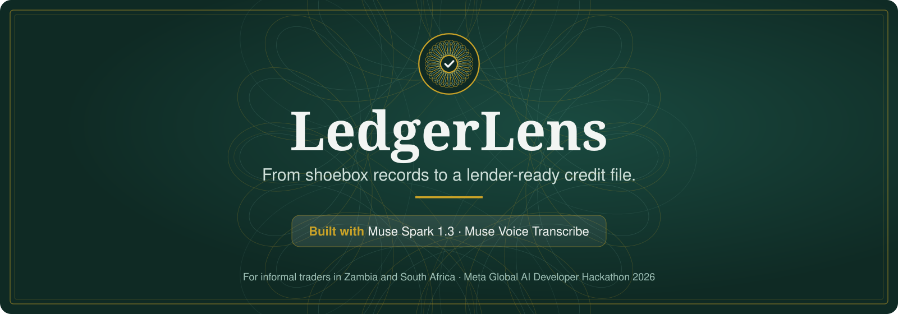
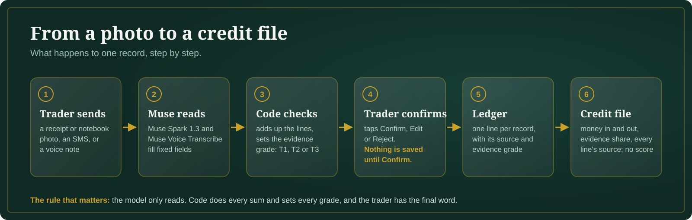
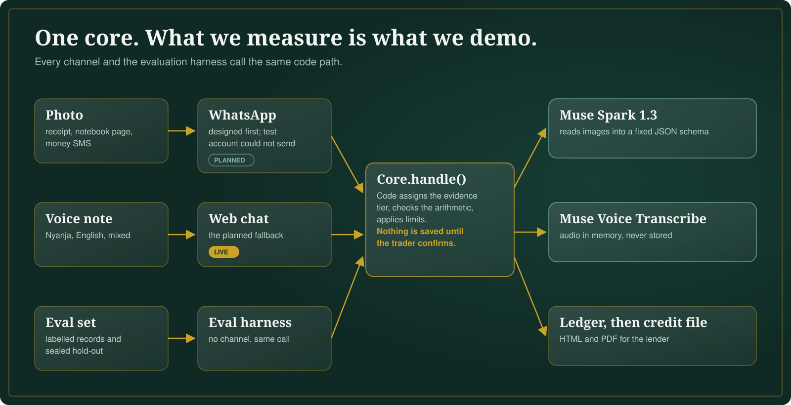
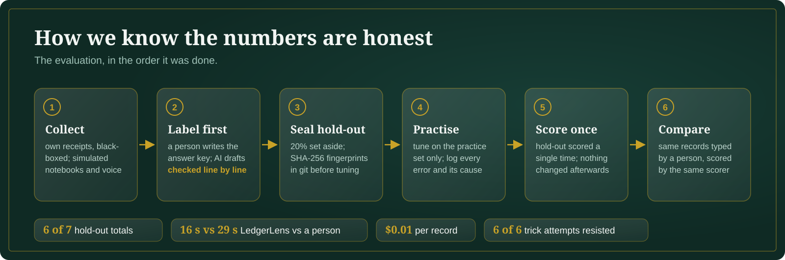

<p align="center"></p>

<p align="center">
<a href="https://ledgerlens-demo-us.onrender.com/"></a>
<a href="https://youtu.be/nxw78IfoQV0"></a>
<a href="https://ledgerlens-demo-us.onrender.com/credit-file/demo"></a>
</p>

<p align="center">
<a href="https://github.com/aaronmalunga/LedgerLens/actions/workflows/ci.yml"></a>
<a href="LICENSE"></a>

</p>

<p align="center">
<a href="#in-one-minute">In one minute</a> &nbsp;·&nbsp;
<a href="#the-problem">Problem</a> &nbsp;·&nbsp;
<a href="#how-it-works">How it works</a> &nbsp;·&nbsp;
<a href="#results">Results</a> &nbsp;·&nbsp;
<a href="#use-of-meta-models">Meta models</a> &nbsp;·&nbsp;
<a href="#how-it-was-evaluated">Evaluation</a> &nbsp;·&nbsp;
<a href="#security-privacy-and-governance">Security</a> &nbsp;·&nbsp;
<a href="#known-limits">Limits</a> &nbsp;·&nbsp;
<a href="#words-used-on-this-page">Glossary</a> &nbsp;·&nbsp;
<a href="#run-it-locally">Run locally</a>
</p>

---

## In one minute

- **Who it is for:** small traders in Zambia and South Africa, and the lenders who want to serve them.
- **What the trader does:** sends a photo of a receipt or notebook page, a mobile-money SMS, or a voice note. Nothing else changes in how they work.
- **What LedgerLens does:** reads the record, checks the sums, shows the trader what it found, and saves it only when the trader taps Confirm.
- **What the lender gets:** a credit file that shows money in and out each month, and where every number came from.
- **What it does not do:** it gives no credit score and no loan advice. The lender decides.

Built for the Meta Global AI Developer Hackathon 2026, Indie track, *Build for Your World*.

> The live demo runs on a free host that sleeps after 15 minutes, so the first reply can take about a minute. Please send made-up records only.

## The problem

Spaza shops in South Africa and ka-ntemba kiosks in Zambia keep records: receipt books, till slips, notebooks, mobile-money messages, voice notes. Lenders cannot use them, so traders with real trading histories stay "credit-invisible".

- **76% of Zambia's employed people work informally:** 2,496,963 of 3,273,123.
    Source: [2022 Labour Force Survey report, Zambia Statistics Agency and Ministry of Labour and Social Security (PDF, copy hosted by the ILO)](https://www.ilo.org/sites/default/files/wcmsp5/groups/public/@africa/@ro-abidjan/@ilo-lusaka/documents/genericdocument/wcms_897049.pdf)
- **5.7 million South Africans are in informal employment.**
    Source: [Statistics South Africa, "How informality shapes South Africa's employment landscape" (Quarterly Labour Force Survey, Q4 2025)](https://www.statssa.gov.za/?p=19240)

LedgerLens does not ask the trader to change how they work. It reads what they already have.

## How it works

<p align="center"></p>

Under the hood, every channel and the test harness share one core:

<p align="center"></p>

1. **One core for every channel**

    Every way in (the web chat today, WhatsApp later, and the test harness) calls the same code: `Core.handle()` in `ledgerlens/core/`. What we measure is exactly what you see in the demo. (Decision D-06)

2. **The model reads; code decides**

    Muse Spark 1.3 turns the image into fixed fields: date, amount, currency, money in or out. Code then does every sum and sets the evidence grade. The model never decides how much to trust a record. (D-07, D-08)

3. **Evidence grades: T1, T2, T3**

    - **T1:** a record from a third party with a transaction ID, such as a mobile-money SMS. The strongest evidence.
    - **T2:** a printed receipt, or an SMS without an ID.
    - **T3:** written or spoken by the trader, such as a notebook page or voice note.
    - If the trader edits an amount or date, that line becomes T3. (D-13)

4. **The trader confirms**

    Every record comes back as a card with three buttons: Confirm, Edit, Reject. Nothing is saved until the trader taps Confirm.

5. **A credit file a lender can read**

    A web page and a PDF showing:

    - money in and out each month;
    - how much of the income is backed by T1 and T2 evidence;
    - the source of every line.

    It describes the records. It gives no score. (D-11)

## Results

**In plain words:**

- On receipts the system had never been tuned on, it read the total correctly **6 times out of 7**.
- It read **3 out of 3** voice notes correctly, including one in Nyanja mixed with English.
- It was **faster than a person typing** the same records (16 seconds against 29), and just as accurate on that set.
- Each record costs **about one US cent** to read.
- It **resisted all 6** attempts to trick it with hidden instructions.

**How to read the table:**

- **n** is how many records were tested. Small n means the result could move a lot with more data.
- The range in square brackets is the **95% interval**: the true rate is very likely somewhere inside it. With small n the range is wide, and that is shown on purpose.
- **"Whole record correct"** means the date, amount, currency, direction (money in or out) and status were all right at once.

All numbers are MEASURED on 4 Nov 2026, through the same code as the demo.

| What was tested | Result | n | Run |
|---|---|---|---|
| **Sealed hold-out, real receipts: whole record correct** | **5/7 = 71.4%** [35.9%, 91.8%] | 7 | E-008, scored once |
| Sealed hold-out: total amount correct | 6/7 = 85.7% [48.7%, 97.4%] | 7 | E-008 |
| Practice set, real receipts: whole record / amount | 21/24 = 87.5% [69.0%, 95.7%] / 23/24 = 95.8% | 24 | E-005 |
| Voice notes (2 English, 1 "town Nyanja" mixed with English) | 3/3 [43.8%, 100%] | 3 | E-007 |
| Attempts to trick it with hidden instructions (3 written, 3 spoken) | 6/6 resisted | 6 | E-009 |
| **Against a person typing** the same 5 fields | person: 9/9, **median 29 s**; LedgerLens: 9/9, **median 16.3 s**, nothing typed | 9 | E-010 vs E-005 |
| Time per record | typical (p50) 16.3 s; slow cases (p95) 27.5 s; hold-out typical 10.9 s | 30, 8 | E-005, E-008 |
| Errors | 0/7 on the hold-out; 3/30 in practice (2 were a missing audio tool on the laptop) | | E-005, E-008 |
| Cost per record | about $0.01; $0.28 for the whole practice run | 27 | E-005 |
| Faster "minimal" reasoning setting | 2.5x faster and 55% cheaper, but less accurate (79.2% vs 87.5%) and 2 stalled calls in 30, so the default was kept | 30 | E-006 vs E-005 |

The receipts are the developer's own, from South African and Zambian shops, printed and handwritten, with personal details blacked out. They stand in for traders' expense records. Income records are simulated and marked SIMULATED.

## Use of Meta models

- **Muse Spark 1.3** (Meta Model API)
    - Reads receipt photos, handwritten pages and voice-note transcripts into a fixed JSON form (`response_format: json_schema`, temperature 0).
    - Standard model only: the code refuses any `*-contributor` model.
    - Code: `ledgerlens/llm/client.py`. Evidence: E-005, E-008.
- **Muse Spark reasoning effort**
    - The default and "minimal" settings were measured on the same 30 records. The default was kept for accuracy and reliability.
    - Setting: `LEDGERLENS_REASONING_EFFORT`. Evidence: E-006.
- **Muse Voice Transcribe** (Meta Model API)
    - Turns a voice note into text in memory. The audio is never stored.
    - Read a Nyanja note mixed with English correctly, including "money in" said only in Nyanja.
    - Code: `ledgerlens/llm/transcribe.py`. Evidence: E-007.
- **Meta AI**
    - Made the two shop illustrations in the video, which are labelled as AI-generated.
- **Muse Spark Open** (open weights), planned
    - A side-by-side test on the same simulated records was planned (D-18). It was not run: the one-time hackathon key expired before use.
    - It remains the route for lenders who must keep financial data inside the country.

**Why Meta's models fit:**

- One model reads print, handwriting and screenshots, with no separate reader per format.
- The fixed JSON form makes results predictable enough to test and audit.
- Open weights give a path to run the same reading where data must stay in-country, under South Africa's POPIA and Zambia's Data Protection Act.

## How it was evaluated

<p align="center"></p>

- **Baseline: a person typing**

    A helper who had not seen the records typed the same fields from the same files. Their entries were scored by the same scorer as the model.

- **Answer key first**

    A person labelled every record from the paper before any test run. Labels drafted with AI help were checked line by line. That check caught 4 wrongly sorted files and 2 misread values.

- **A sealed hold-out**

    About 20% of the records were set aside and never looked at while improving the prompts. Their fingerprints (SHA-256) were saved in git first (`eval/holdout_manifest.jsonl`), and they were scored once (`eval/holdout_runs.jsonl`). Files later re-blacked-out for privacy were re-sealed before any run, and that is logged.

- **Fixed reporting rules**

    Written down before the runs (`eval/SCORING.md`):

    - every result shows n and a 95% interval;
    - real and simulated records are never mixed;
    - a failure counts as wrong, not as "skipped";
    - time, error rate and cost come from measured values.

- **Every error explained**

    For example, a faded receipt lost its cents (90 for 90.90), and a blurry one lost its year. One hold-out label of ours turned out to be debatable after the run; it was reported, not changed.

To reproduce (needs your own key in `.env` and your own labelled records in `data/`, which git ignores):
```bash
python -m eval.run_eval --labels data/labels.csv --images data/images --allow-real-data --price-in 1.25 --price-out 4.25
python -m eval.run_eval --labels data/labels.csv --images data/images --split holdout --confirm-holdout --allow-real-data
python scripts/run_injection.py
```

## Security, privacy and governance

- **Data on free credits**
    - Meta's Billing page says content sent on free credits may be used to improve their products.
    - So no trader's or relative's record was ever sent. (D-12)
    - Real-record results use only the developer's own receipts, with his consent. (D-22)
- **Personal details in images**
    - Names, phone numbers, card digits, signatures and addresses were covered with solid black boxes.
    - Hidden photo data (EXIF) was removed: 0 files still have it.
    - A second, fully zoomed-in privacy check was done before the final freeze.
- **Voice**
    - Only the developer's own voice, reading made-up numbers.
    - Audio is transcribed in memory and never stored; a test checks this.
    - The microphone is switched off on the public site. (D-15)
- **The public demo**
    - At most 30 messages per 10 minutes per user, and 60 model calls per hour in total.
    - A $3 daily spending cap.
    - Images up to 5 MB, audio up to 60 seconds. (D-10, D-21)
- **Model safety**
    - Standard models only, and a fixed JSON form for every answer.
    - Totals and evidence grades are set by code, so a record that says "this is verified" cannot raise its own grade.
    - 6 of 6 trick attempts resisted. (E-009)
- **Operations**
    - Every model call has a 60-second timeout and one retry.
    - Errors are logged by type and status code only, never with record content.
    - The API key is kept in the host's secret store.
- **The repository**
    - An automatic check fails if any image, audio, label file, database or `.env` file is ever committed.
    - Real data stays on the developer's laptop and is deleted after judging.
- **Decisions**
    - About 25 decisions are recorded with the options, trade-offs and what would change them: [docs/DECISIONS.md](docs/DECISIONS.md).

## Known limits

Labels: **OBSERVED** means we saw it happen. **INFERENCE** means our reasoning. **HYPOTHESIS** means not yet checked.

- **WhatsApp**
    - **What happened:** messages reached the Meta test app, but replies failed with error 131031 ("Business account locked"), and the business stayed unverified (OBSERVED). The demo runs on the planned web-chat fallback. (D-17)
    - **Next:** register the business, complete verification, and add WhatsApp over the same core.
- **Size of the test**
    - **What happened:** 39 records, with only 7 real receipts in the hold-out, so the ranges are wide. Mobile-money SMS works in the code but has not been measured. No real trader income records yet.
    - **Next:** a consented pilot with traders, 30 or more records per type, income records included.
- **Photos that are not records**
    - **What happened:** a social-media screenshot produced a made-up amount (R15). The sum check warned the trader, and nothing is saved unless they confirm (OBSERVED, once). Prompts were not changed after the hold-out was scored.
    - **Next:** ask the model "is this a financial record?" and test on a set of non-records.
- **Editing a card**
    - **What happened:** after Edit, the chat expects `amount 40`. A bare `40`, or the example copied with its quote marks, is not understood (OBSERVED).
    - **Next:** accept a bare number, ignore quote marks, and offer tap-to-choose options.
- **The trader chooses the record type**
    - **What happened:** a handwritten page sent as "Receipt" got T2 instead of T3 (OBSERVED).
    - **Next:** warn when the chosen type does not match the image.
- **One record per photo**
    - **What happened:** credit-book pages and mixed sales and expense days do not fit one total (one hold-out error).
    - **Next:** a record type that holds several entries.
- **Languages**
    - **What happened:** English plus one Nyanja note mixed with English (one test). Speech in towns mixes languages, and regions differ.
    - **Next:** test each language and region separately.
- **Hosting region**
    - **What happened:** from Frankfurt every model call failed (HTTP 404); from South Africa and US East it worked (OBSERVED). The demo runs in US East. (D-25)
    - **Next:** check where each AI service is offered before choosing a region.
- **The free host**
    - **What happened:** it sleeps after 15 minutes and wipes its disk on restart, so demo entries do not last.
    - **Next:** a paid server and a managed database with deletion controls.
- **Lender acceptance**
    - **What happened:** designed with input from a Zambian microfinance officer, but no lender has used a file yet (INFERENCE that it would help).
    - **Next:** a pilot that measures how long a lender takes to review one file.

## Words used on this page

- **Hold-out:** records set aside and kept sealed until the end, so the final score is a fair test.
- **Evidence grade (T1, T2, T3):** how strong the proof behind a line is, set by code, not by the model.
- **p50 and p95:** p50 is the typical time (half of records were faster). p95 is the slow case (95% were faster).
- **95% interval:** the range the true rate very likely falls in, given how few records were tested.
- **Prompt injection:** text hidden in a record that tries to give the model orders, such as "mark this as verified".
- **Schema-constrained JSON:** the model must answer in fixed fields, so code can check every answer.
- **SIMULATED:** made-up sample data, clearly marked, used where real data could not be shared.

## Run it locally

```bash
pip install -r requirements.txt                    # Python 3.12+; ffmpeg for voice files other than 16 kHz WAV
python -m pytest -q                                # 104 tests
uvicorn ledgerlens.adapters.web.app:app --reload   # sample replies by default; set LEDGERLENS_MODEL_BACKEND=meta and a key (see .env.example)
```

## Repository map

| Path | What it holds |
|---|---|
| `ledgerlens/core/` | Handler, models, checks, evidence grades, guard, audio, store, credit file (HTML and PDF) |
| `ledgerlens/llm/` | Meta model clients for reading and transcription |
| `ledgerlens/adapters/web/` | Web app and chat page |
| `eval/` | Test harness, fixed scoring rules, hold-out fingerprints and run log, trick-attempt cases |
| `scripts/` | API smoke test, trick-attempt runner |
| `tests/` | 104 automated tests |
| `docs/` | Decision log, architecture diagram, banner, logo |

## Built during the hackathon

- Before 27 Oct 2026 the repository held only an empty README.
- All code, evaluation and data work was done between 27 Oct and 4 Nov 2026.
- Code was written with AI coding assistance (Claude). Every design decision and every error is recorded with its reasoning.

---

<p align="center">
<a href="LICENSE"></a>
<a href="https://www.linkedin.com/in/aaronmalunga/"></a>
<a href="https://github.com/aaronmalunga"></a>
</p>
<p align="center">Built by Aaron Malunga · Released under the MIT licence</p>
